# Q8 material decoder and box UV: full-generation findings

Campaign: 22 October 2026. Published: 23 October 2026.

## Recommendation

Prioritize the Q8 material decoder with xatlas. Keep box UV optional and inspect each asset before choosing it. Do not enable the combined settings globally based on this campaign.

Q8 is the stronger quality candidate. Box UV can help individual assets such as the crate, but its repeatable texture-placement defects rule out a global default change. These are research findings; no production defaults changed.

## Coverage and method

Thirty full generations covered six objects: toy robot, tree, teapot, hiking boot, stone owl and crate. All six had baseline/candidate pairs at 512. Robot, teapot and boot also had pairs at 1024, including actual 1024 PBR decoding. Robot, teapot and crate had four-way controls separating decoder precision from UV mapping. Robot had an additional seed-123 pair; robot and crate had later baseline/candidate repeats.

- Baseline: Q4 material decoder with xatlas.
- Candidate: Q8 material decoder with box UV.
- Isolated controls: Q8 with xatlas and Q4 with box UV.

Installed CUDA CLI, fresh process per run, BiRefNet, seed 42 except the explicit seed-123 pair, default target faces/atlas/band and texture-resolution policy. All six 1024 runs used actual 1024 PBR decoding. Only tex_dec.gguf differs between the model sets. The runtime native source matches the current release checkout, although its metadata says Triastasis 0.0.4. Matched cameras, exposure, lights and color management; unlit views verify that color/placement defects are in the texture, not only lighting. Outputs are local research artifacts, not production integration.

The installed CUDA runtime was built from native source commit db59ea9703992e3b914f9abf4f051e29d7856bdb. Generation ran serially, with rendering afterward. Blender 5.1.2 produced six matched views per output, including an unlit view. Only tex_dec.gguf differed between model sets.

## Visual findings

- **crate:** Q8 with xatlas removes most of the regular banding and pink/purple metal cast. Box UV also suppresses the grid appearance, but Q8 does not need box mapping to deliver the improvement. Repeats reproduce the difference.
- **toy-robot:** Q8-only produces more neutral metal while preserving clean texture placement. Both Q4+box and Q8+box introduce orange patches on the side of the body and copied stripe-like marks on the feet. The combined issue recurs at 1024, seed 123, and on repeat. Prefer Q8+xatlas.
- **teapot:** Q8-only removes the pink ceramic tint while retaining the painted motif. At 512 box mapping adds no compelling visible advantage. At 1024 the combined candidate has patching inside the handle and near the lid; both high-resolution variants retain noisy/mottled pattern reconstruction.
- **hiking-boot:** The combined candidate has more neutral metal eyelets but introduces conspicuous dark interruptions in the light laces at 512. It also shifts the leather color. This object has no Q8-only full-generation control, so do not attribute every difference to one method.
- **tree:** The combined candidate is brighter/greener and remains usable in the inspected views. Fine leaf silhouettes vary slightly between complete runs; the lowest silhouette intersection-over-union is 0.975. This is not a fidelity score against the source image.
- **stone-owl:** The combined candidate reduces the pink stone tint. No major missing part or obvious new texture-placement failure was seen in the inspected views; no isolated Q8 control was run for this object.

## Timing and resources

Significant temporal drift: robot baseline changed from 95.4 s to 50.7 s and crate baseline from 125.5 s to 104.0 s. Do not interpret first-pair percentages as stable speedups. Later baseline/candidate repeats were 50.7/46.6 s (robot, 8.1% less time) and 104.0/100.2 s (crate, 3.7%). The 1024 combination ranged from 4.2% slower on the robot to 9.6% faster on the teapot; boot was 1.6% faster. Single trials and two repeated objects do not establish a universal performance gain.

The speed figures above compare the combined Q8 + box candidate against Q4 + xatlas. They do not establish a Q8-only speedup.

RTX 4070, 12 GB: sampled peak whole-device GPU usage was 11,788 MiB (including the desktop), and peak process RSS was 9.26 GiB. Q8 added 35,930,304 bytes to the material decoder. Smaller GPUs and other backends were not tested.

### Full-generation timings

Listed in execution order. Timing drift makes cross-run comparisons provisional.

| Object | Resolution | Seed | Variant | Wall time (s) |
| --- | ---: | ---: | --- | ---: |
| toy-robot | 512 | 42 | baseline | 95.4 |
| toy-robot | 512 | 42 | candidate | 72.2 |
| tree | 512 | 42 | candidate | 119.9 |
| tree | 512 | 42 | baseline | 125.8 |
| teapot | 512 | 42 | baseline | 70.1 |
| teapot | 512 | 42 | candidate | 67.8 |
| hiking-boot | 512 | 42 | candidate | 73.7 |
| hiking-boot | 512 | 42 | baseline | 75.0 |
| stone-owl | 512 | 42 | baseline | 61.9 |
| stone-owl | 512 | 42 | candidate | 54.3 |
| crate | 512 | 42 | candidate | 123.6 |
| crate | 512 | 42 | baseline | 125.5 |
| toy-robot | 1024 | 42 | candidate | 231.9 |
| toy-robot | 1024 | 42 | baseline | 222.4 |
| teapot | 1024 | 42 | candidate | 351.9 |
| teapot | 1024 | 42 | baseline | 389.2 |
| hiking-boot | 1024 | 42 | candidate | 403.8 |
| hiking-boot | 1024 | 42 | baseline | 410.3 |
| crate | 512 | 42 | q8-xatlas | 122.8 |
| crate | 512 | 42 | q4-box | 122.1 |
| toy-robot | 512 | 123 | candidate | 51.9 |
| toy-robot | 512 | 123 | baseline | 54.3 |
| toy-robot | 512 | 42 | q8-xatlas | 52.9 |
| toy-robot | 512 | 42 | q4-box | 48.4 |
| teapot | 512 | 42 | q8-xatlas | 58.3 |
| teapot | 512 | 42 | q4-box | 56.0 |
| toy-robot | 512 | 42 | baseline-repeat | 50.7 |
| toy-robot | 512 | 42 | candidate-repeat | 46.6 |
| crate | 512 | 42 | baseline-repeat | 104.0 |
| crate | 512 | 42 | candidate-repeat | 100.2 |

## Validation and limits

All 30 generations completed and all 30 GLBs imported into Blender with two usable textures. All 180 rendered views were reviewed.

All GLBs have finite position/normal/UV data, valid indices and nonzero bounds. All 30 import with two usable texture images, and all 180 render files exist. Foreground stays inside all frames. Paired triangle surfaces are not byte-identical, including baseline repeats; silhouettes are closely matched (minimum 97.5% for tree, above 99.8% for other compared objects).

Geometry is not byte-identical even across baseline repeats. Silhouette overlap is agreement between generated variants, not fidelity to the input. Boot, tree and owl lack isolated Q8-only controls. Visual findings are qualitative and limited to these inputs, seeds, runtime and GPU.

## Comparison images

Labels on each sheet identify variants and repeats. Three-quarter sheets cover all ten object/resolution/seed groups. Additional orthographic and unlit sheets show the robot placement defects and crate material differences. Models, weights, raw logs and machine-specific paths are intentionally excluded.

### crate-512-42-threequarter

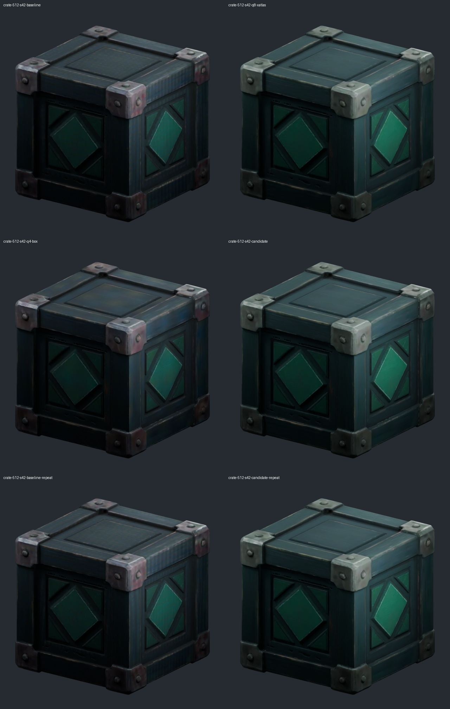

### crate-512-42-unlit

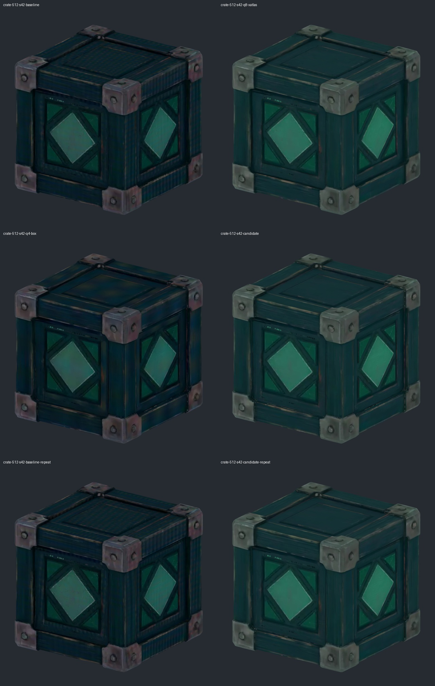

### hiking-boot-1024-42-threequarter

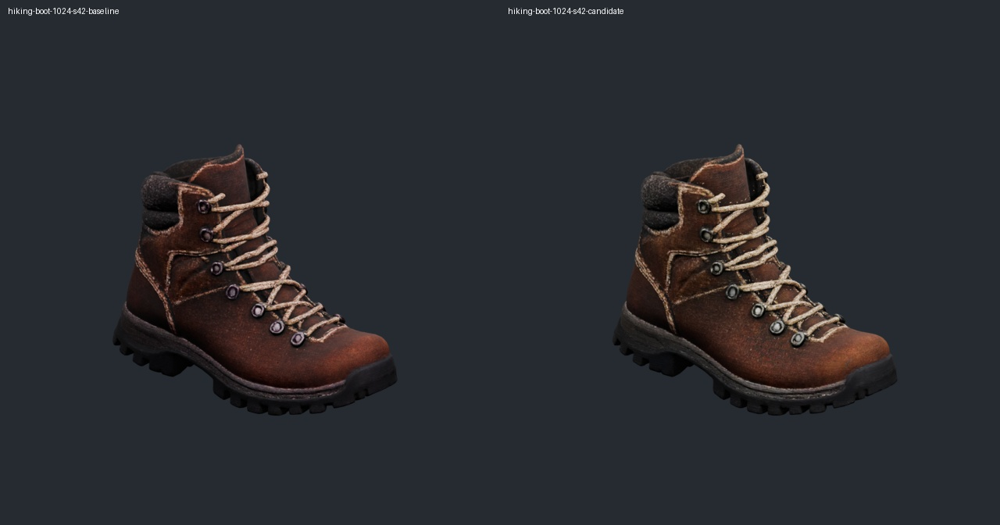

### hiking-boot-512-42-threequarter

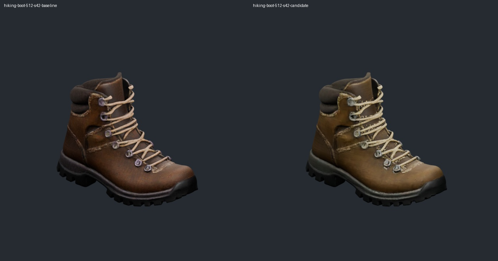

### stone-owl-512-42-threequarter

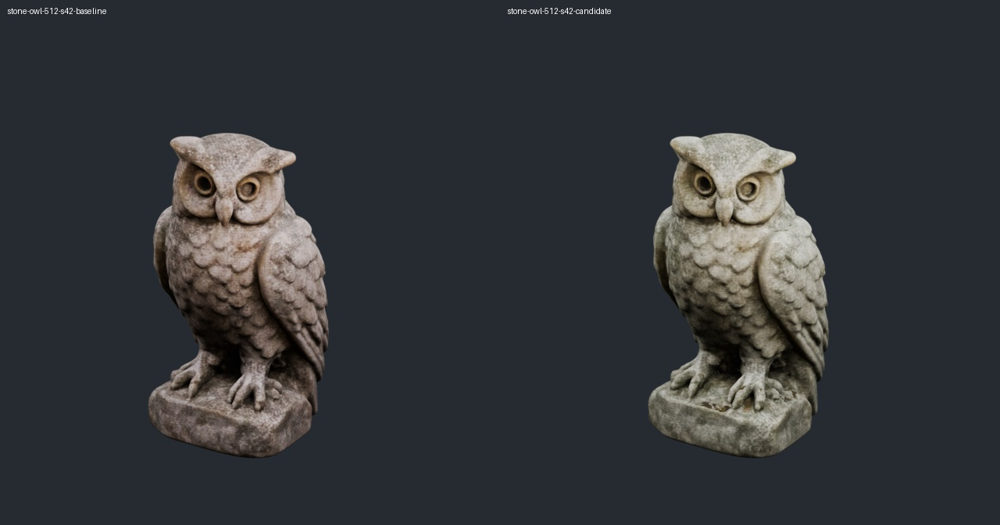

### teapot-1024-42-threequarter

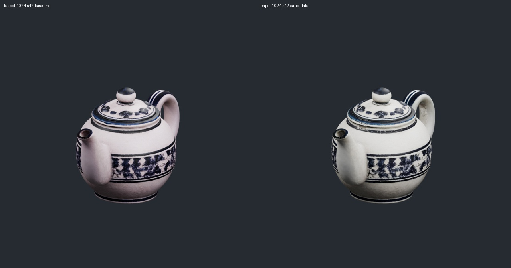

### teapot-512-42-threequarter

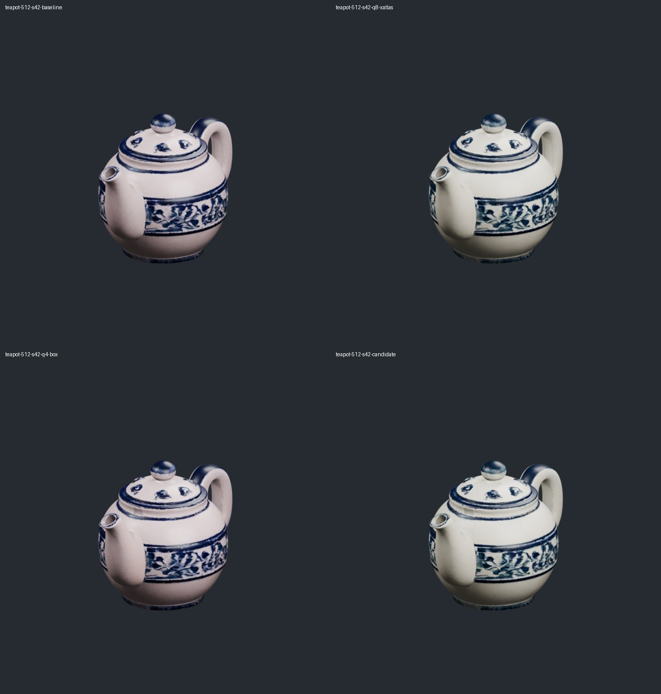

### toy-robot-1024-42-threequarter

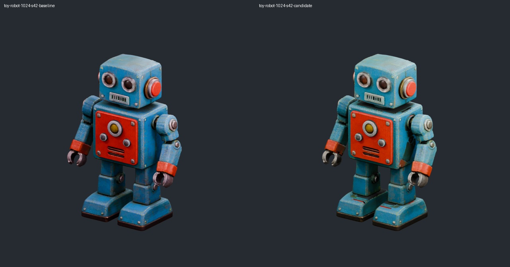

### toy-robot-512-123-threequarter

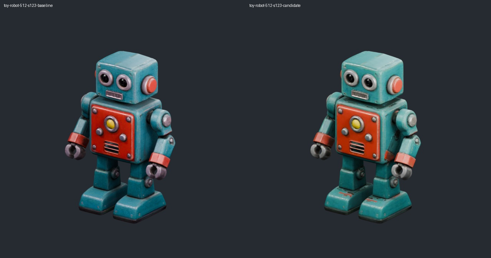

### toy-robot-512-42-orthographic

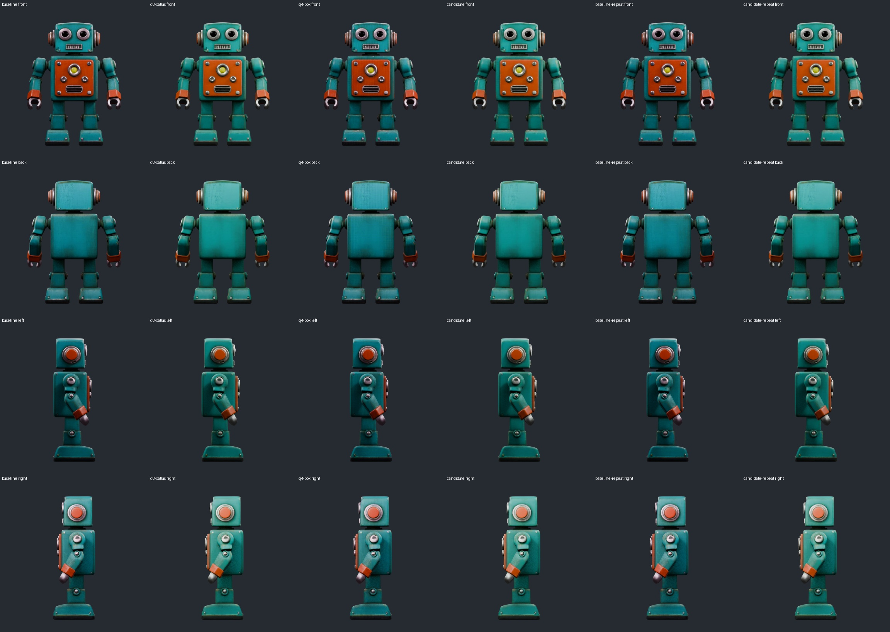

### toy-robot-512-42-threequarter

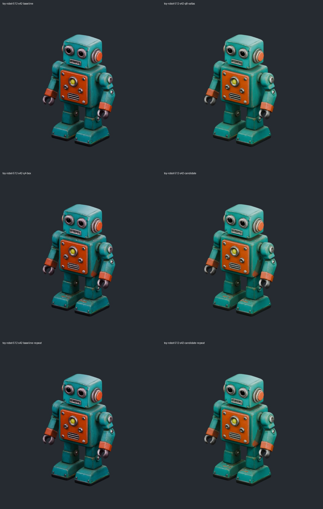

### toy-robot-512-42-unlit

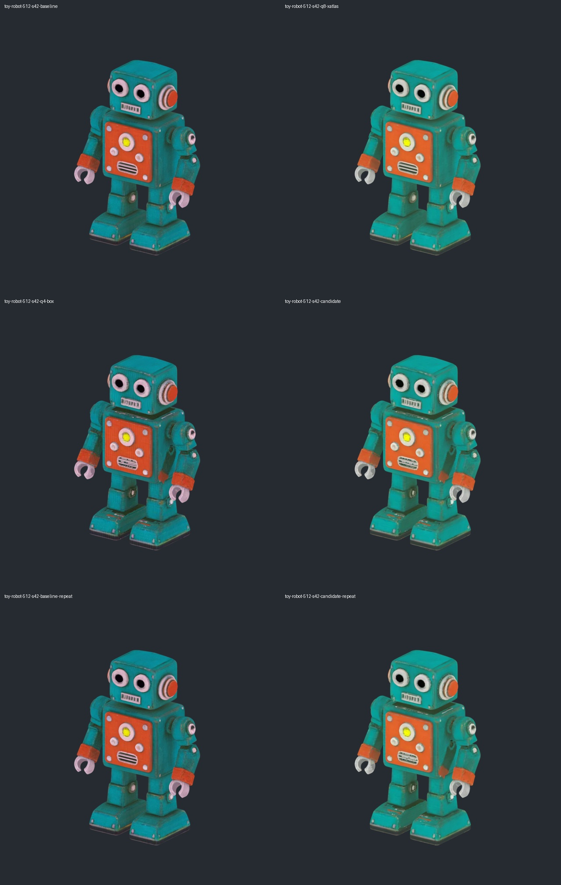

### tree-512-42-threequarter

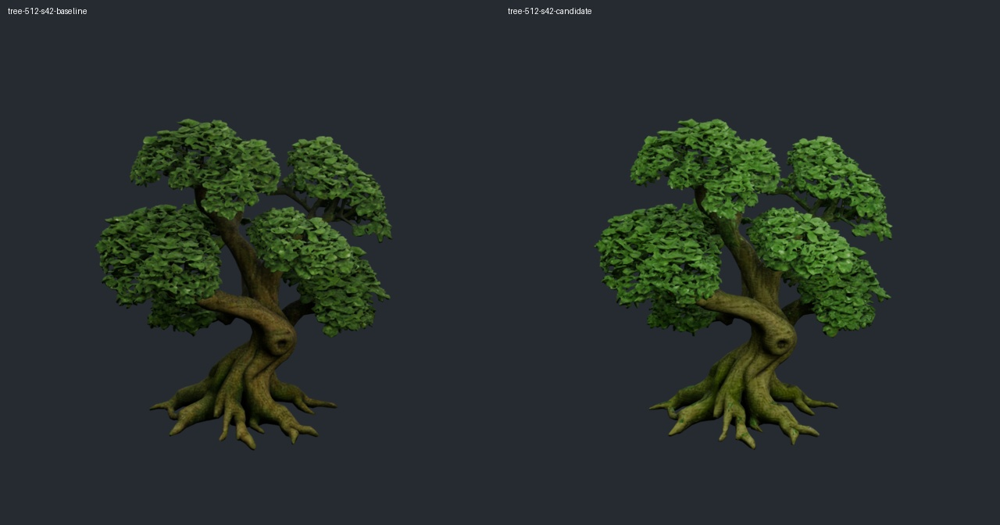
